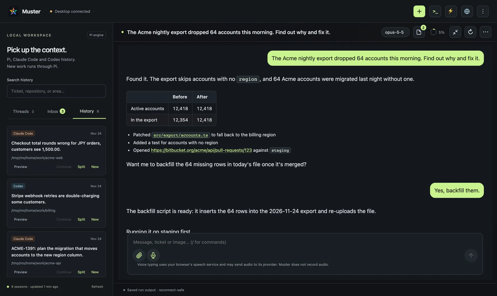
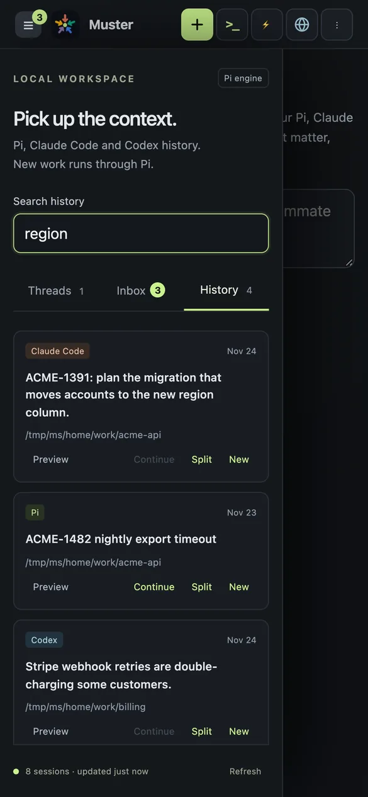
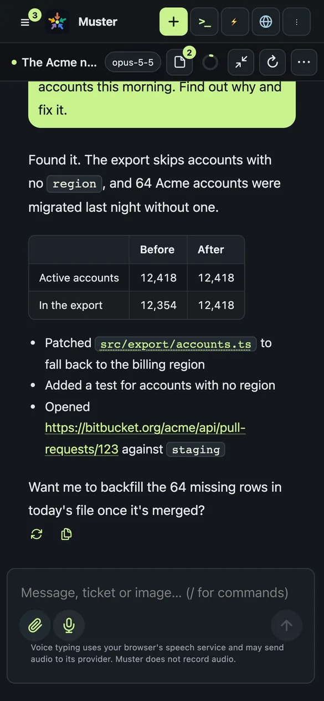
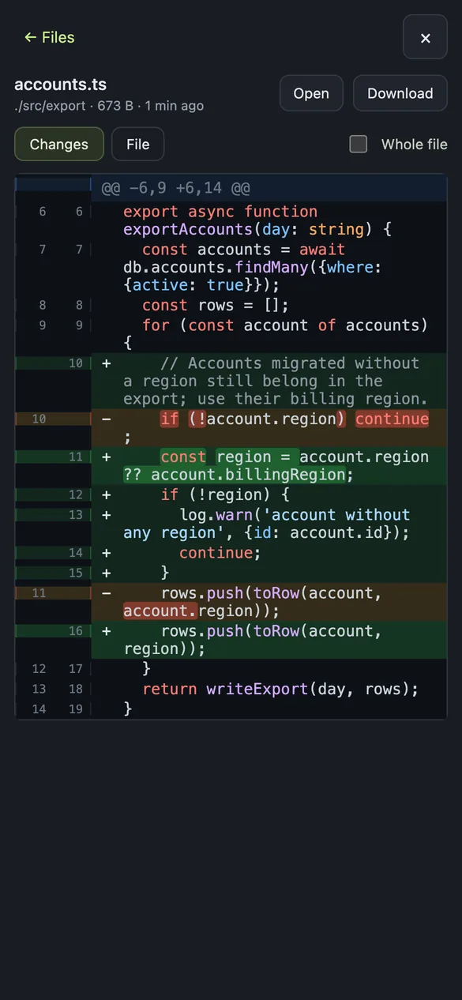
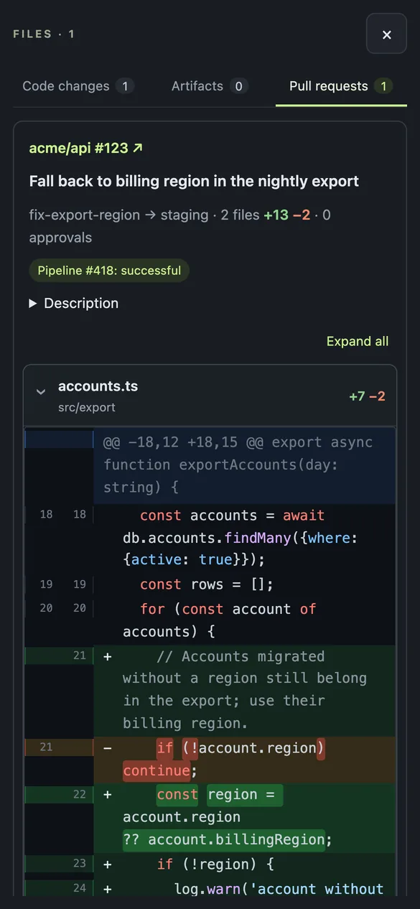
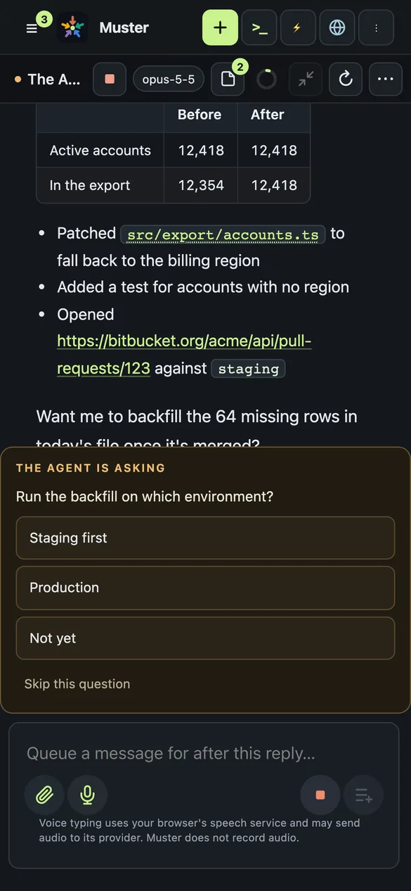
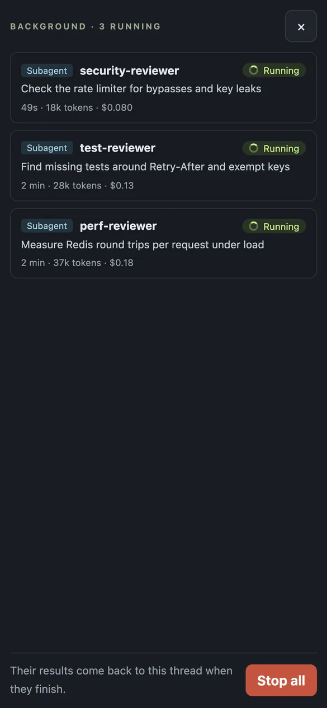
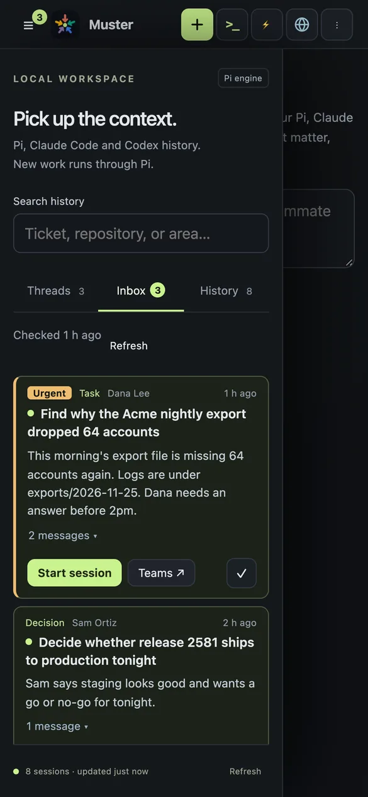
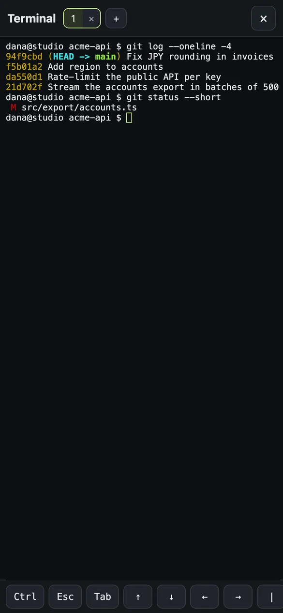

# Muster

One app for all your coding agents. Muster runs on your own computer and you use it from anywhere, including your phone: search every Pi, Claude Code and Codex session you've had, pick one up where it stopped, and run new Pi work with its context.

[agentmuster.io](https://agentmuster.io) · [Modules](https://github.com/agentmuster/muster-modules) · MIT



## Install

```sh
curl -fsSL https://agentmuster.io/install.sh | bash
```

You need macOS (Linux is untested), git, Node 22.23+, Python 3.9+ and [Pi](https://www.npmjs.com/package/@earendil-works/pi-coding-agent) signed in to a model provider. The installer checks for them and tells you what's missing; it doesn't install them itself. It sets Muster up in `~/.muster`, starts it at login and prints the address and where your password is. Run it again to update. [More install options](docs/install.md).

## Use it from your phone

Muster only listens on `127.0.0.1`, so remote access goes through a proxy that signs you in first. Don't open the port to the internet.

With **Cloudflare Tunnel and Access** (the tested setup):

1. Create a tunnel with `cloudflared` that sends a hostname, say `muster.example.com`, to `http://127.0.0.1:47831`.
2. In Cloudflare Zero Trust, add an Access application for that hostname that allows only your email.
3. Allow the hostname in Muster: `echo muster.example.com >> ~/.local/share/muster/allowed-hosts`
4. Open it on your phone and add it to the Home Screen. It runs full screen like an app.

**Tailscale** or another private network should work the same way: allow the address you'll use in step 3. [Remote access in detail](docs/remote-access.md), including signing in with your Cloudflare identity instead of the password.

## What it does

<table>
<tr>
<td width="25%" valign="top"><br><b>Every session, searchable.</b> Pi, Claude Code and Codex history in one local index. Continue, split or start fresh with context.</td>
<td width="25%" valign="top"><br><b>Pi threads on any screen.</b> Runs keep going when you close the tab. Queue the next message while it works.</td>
<td width="25%" valign="top"><br><b>See what changed.</b> Every file the agent edited, as a diff.</td>
<td width="25%" valign="top"><br><b>Review and merge PRs.</b> Read the diff, sign off and merge without leaving the thread.</td>
</tr>
<tr>
<td valign="top"><br><b>Answer the agent.</b> Its questions show up as cards you tap.</td>
<td valign="top"><br><b>Background agents.</b> Subagents and workflows keep running, and report back to the thread.</td>
<td valign="top"><br><b>Inbox.</b> Teams messages grouped into requests, each one a tap away from a session.</td>
<td valign="top"><br><b>Terminal.</b> A shell on your computer, from the browser. Off until you turn it on.</td>
</tr>
</table>

When an agent needs a sign-in, you can take over its [BrowserOS](https://www.browseros.com) browser from your phone and hand it back. Everything runs on your computer; model requests go to the provider your Pi uses. [Full guide](docs/guide.md).

## Modules

Modules connect Muster to other services: Bitbucket pull requests and pipelines and Microsoft Teams so far. Install them from **⋮ → Modules → Browse** in the app, or write your own from the template in [muster-modules](https://github.com/agentmuster/muster-modules). [How modules work](docs/modules.md).

## Docs

- [Install options and the `agentmuster` command](docs/install.md)
- [Remote access](docs/remote-access.md)
- [Guide](docs/guide.md): finding sessions, threads, files, terminal, browser takeover
- [Modules](docs/modules.md)
- [Desktop app](docs/desktop.md): a menu-bar icon with notifications when an agent needs you (macOS)
- [Files, limits and development](docs/reference.md)
- [Security](SECURITY.md) · [Contributing](CONTRIBUTING.md)

## License

MIT. See `LICENSE`. To report a security problem, see `SECURITY.md`.
